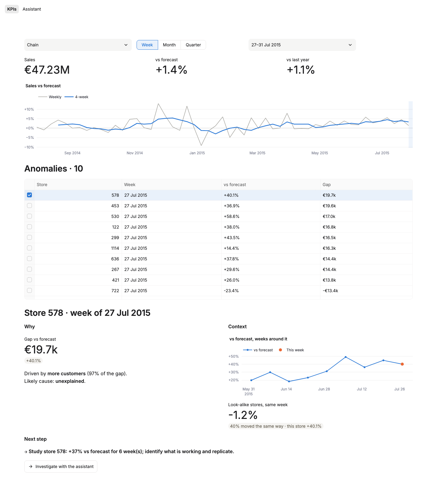
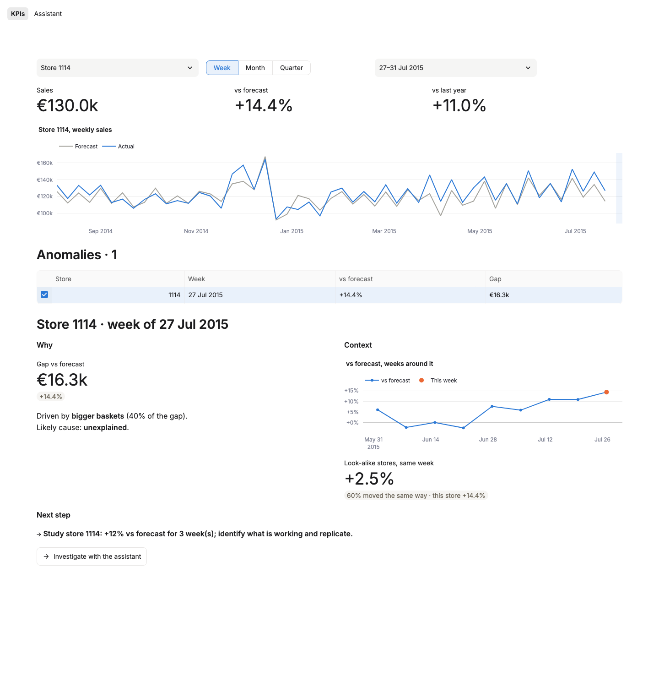
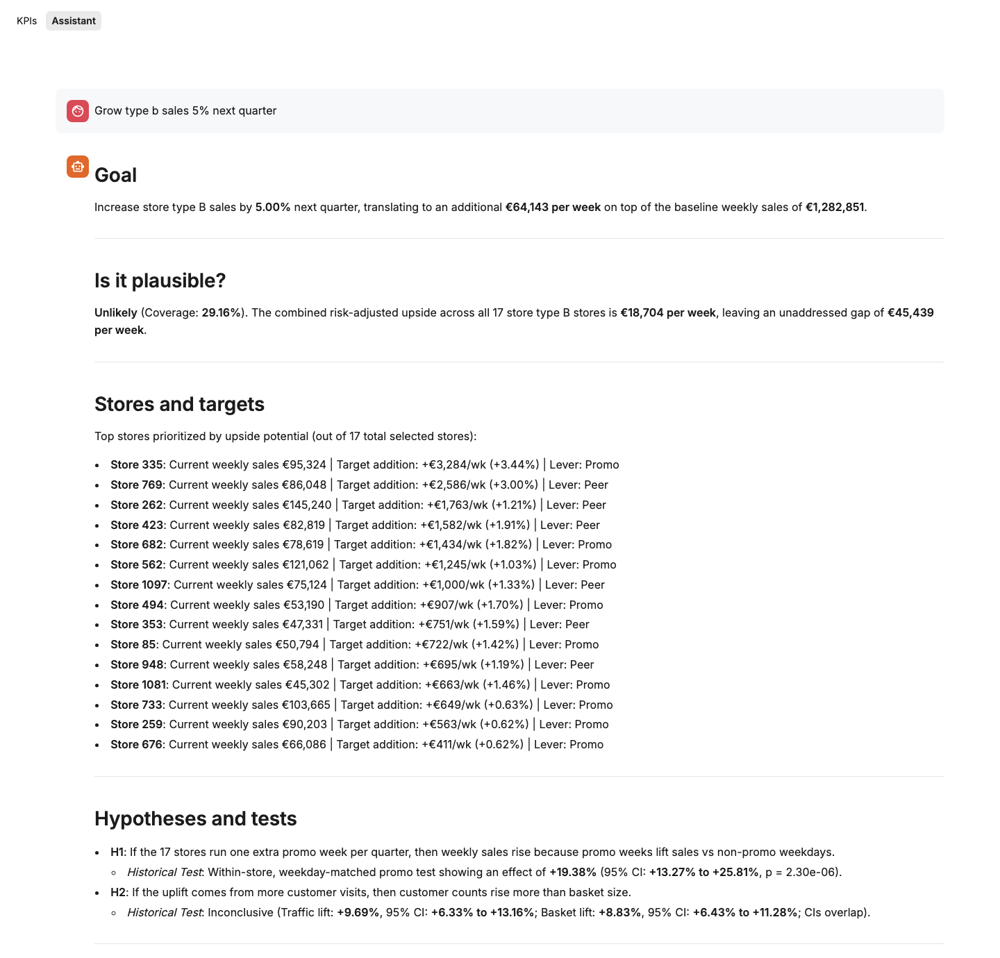
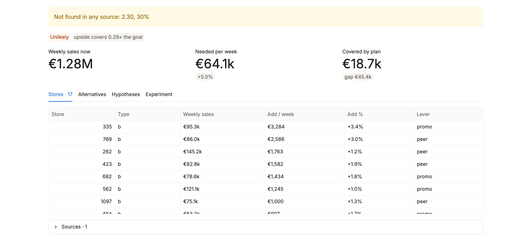

# Sales Insight Copilot



## Overview

This project is a decision-intelligence app for a retail chain. It shows how the chain and every store are doing, flags the weeks that were unusual and says why, and gives a business analyst a junior colleague: an assistant that turns a goal like *"grow type b sales 5% next quarter"* into a plan with target stores, tested hypotheses, an A/B test design and alternatives.

The data is Rossmann's daily sales for 1,115 stores from January 2013 to July 2015, 1,017,209 store-days.

The rule throughout is that **numbers come from code, not from the language model.** Forecasts, anomalies, causal effects, plans and test results are computed deterministically. The LLM (Gemini 3.5 Flash) only writes and converses, and every number it writes is checked against the tool outputs it was given.

- The forecast is off by **6.1% per store-week**, against 9.5% for a seasonal baseline, measured out of sample over four quarters.
- **A promo week lifts a store's sales by 38%** on average, measured within each store against its own non-promo weekdays.
- **A new competitor nearby costs a store 8.2% of sales**, 15.4% within 1 km and 5.4% beyond, from 120 openings. The Promo2 loyalty programme looks positive (+2.9%), but enrolled stores were already declining, so it is reported as unproven.
- **For the type b goal above, the assistant answers *Unlikely*.** The measured upside in those 17 stores covers 0.29 of what the goal needs, and a test inside them would need 230 stores per group to detect the lift.

## The app

**KPIs.** Pick the chain or any store, and a week, month or quarter. Three numbers: sales, against forecast, and against the same days last year. The ten largest anomalies in the period are listed. Opening one shows why it happened, the weeks around it, how look-alike stores did that week, and the recommended next step, with a button that hands the case to the assistant.



**Assistant.** One chat for questions ("which stores fell most last month?") and for plans. For a goal, it asks one clarifying question if the target, scope or time frame is missing, then writes the plan under fixed headings: goal, plausibility, stores and targets, hypotheses and tests, experiment, alternatives, risks and decision.



Under the text, the deterministic plan it was written from is shown in full, with the sources it used. Numbers that do not appear in any source are flagged: here, a p-value it rewrote in scientific notation and a rounding of its own.



## How it works

```
Kaggle CSVs ─▶ DuckDB warehouse ─▶ forecasts ─▶ anomalies ─▶ root cause ─▶ causal effects ─▶ planner
               raw / staged / marts  (rolling     (calibrated   (traffic vs     (within-store,    stores, tests,
               + KPI dictionary       origin)      intervals)    basket, events)  DiD)             A/B design
                                                                                                    │
                                              Streamlit app: KPIs  ·  Assistant (LLM + tools) ◀─────┘
```

**Forecast.** A gradient-boosted tree model (scikit-learn `HistGradientBoostingRegressor`) predicts each store's daily sales from 33 features known in advance: calendar, promotions, holidays, closures, competition, and store averages computed from the training window only. It is retrained each quarter and tested on the next one (rolling origin, four folds from August 2014 to July 2015), so every forecast in the app is out of sample. Prediction intervals come from quantile models, widened by conformal calibration on the previous fold.

**Anomalies.** A store-week is flagged when it is at least 10% off forecast and most of its days fall outside the calibrated interval in the same direction. Consecutive weeks form an episode: 2,001 episodes, 4.7% of store-weeks.

**Root cause.** Each episode is split into fewer or more customers against smaller or bigger baskets, then matched to events: holidays, refurbishment reopenings, competitor openings, and moves shared by the whole store type.

**Causal effects.** The promo effect is a within-store regression of log sales on promo days, against the same store's non-promo weekdays. Competitor openings and Promo2 enrolment use stacked difference-in-differences against stores whose situation did not change, with an event study, a pre-trend test and a placebo.

**Planner.** For a goal, it takes the scope's weekly sales over the last eight complete weeks and compares the euros needed with the measured upside available (`src/sic/opportunity`). It picks the fewest stores that cover the goal and splits the target between them, tests two hypotheses on those stores' history, sizes the alternatives with a Monte Carlo what-if engine, and designs the A/B test.

**Experiments.** Stores are the unit, never store-days. Tests within a store are matched by weekday and paired; tests between stores are Welch tests and are labelled as associations. The A/B design pairs stores by sales and randomises within pairs (seeded, so the split can be reproduced), and the readout adjusts each store by its own pre-period (CUPED).

## How firm are the results?

**The forecast.** Out of sample over four quarters:

| | Seasonal baseline | Model |
|---|---|---|
| Error per store-week (WAPE) | 9.5% | **6.1%** |
| Error per store-day (WAPE) | 12.6% | **8.7%** |
| 90% interval, share of actuals inside (last quarter) | | **90.2%** |

The Christmas quarter is the weakest: interval coverage there is 81%, because no earlier holiday fold exists to calibrate it from.

**Feature selection.** Redundancy clustering, grouped permutation importance, group ablation and backward elimination proposed dropping 6 of the 33 features. The rule, set before the test, was to adopt the smaller set only if it was no worse on a quarter never used to choose it. It was worse (daily error +0.08 points, 95% CI +0.05 to +0.11), so all 33 are kept.

**The causal effects.** The promo effect is a stable property of a store: estimated separately on two periods, it ranks stores almost identically (Spearman 0.95). The competitor effect passes its pre-trend test and placebo. Promo2 fails its pre-trend test (p = 0.0007), so the assistant and the plans call it unproven and suggest a randomised rollout instead.

**The A/B design.** Measuring sales against forecast and adjusting each store by its own history (CUPED) removes 98% of the variance of raw weekly sales. Over two promo cycles a test can then detect a 3.4% lift, where raw sales would need 27.7%. Running longer barely helps; adding stores does.

**The readout.** On real data with +5% added to the test group, the readout recovers it inside its 95% interval, and the CUPED interval is narrower than the raw one. On real past weeks with nothing added (an A/A test), the interval covers zero and the decision is *do not roll out*.

**The language model.** A card-checking gate was tested on cards with defects injected on purpose. The rules alone catch 74% of the defects; with an LLM critic, 100%, with no false alarms on correct cards. The agent answers 13 of 15 questions in a golden set correctly. In the live plan above, 98.5% of the numbers it wrote are found in its sources.

## Checks

`tests/` holds 61 tests (`make test`). Among them:

- the KPIs for any period match the weekly scorecard exactly on three test weeks, Christmas included
- the hypothesis tests recover known effects from synthetic data, and the between-store interval covers the true value in 97% of 200 simulated datasets
- the readout recovers an injected +5% lift, and a dry run on history behaves as an A/A test
- the planner gives identical plans and test groups for the same goal, its verdict and coverage agree, and it never calls a hypothesis supported when the confidence intervals overlap
- the per-store competitor effects average to the pooled study within 3 points
- every page renders, for the chain and for a store, and an anomaly hands off to the assistant (with the LLM stubbed, so tests spend no tokens)

## What was found and fixed along the way

- **The first week of the KPIs showed sales 243% above forecast.** The forecasts start on a Friday, so a full week of sales was compared with three days of forecast. Comparisons now use only days that have a forecast.
- **The last week, which ends on a Friday, was not marked partial.** A partial week is now any week with fewer than seven days of data, and charts in euros leave such weeks out.
- **A briefing said sales grew 19.9% on the prior week.** It compared five days with seven. The same-days comparison is +42.7%.
- **The planner called a hypothesis supported because one estimate was higher (+9.7% against +8.8%)** while their intervals overlapped. It now says *inconclusive* unless the intervals separate.
- **The assistant added the chain total to the store types** when answering a chain question, counting sales twice. The tables now tell it that the total is a row of its own.

## Data

The data is the [Rossmann Store Sales](https://www.kaggle.com/competitions/rossmann-store-sales) competition on Kaggle: `train.csv` (daily sales, customers, promotions and holidays per store) and `store.csv` (store type, assortment, competition and Promo2). It is not included in this repository; download it from Kaggle under the competition's rules.

| Path | Holds |
|---|---|
| `sql/` | Warehouse layers (raw, staged, marts) and the KPI dictionary `kpis.yaml` |
| `src/sic/forecast/` | Features, rolling-origin backtest, feature selection |
| `src/sic/detect/`, `src/sic/rca/` | Interval calibration, anomaly episodes, root cause |
| `src/sic/causal/` | Promo lift, Promo2 and competitor difference-in-differences, recommendations |
| `src/sic/planner.py`, `experiment.py`, `hypothesis.py` | Plans, A/B design and readout, hypothesis tests |
| `src/sic/agent/`, `llm/`, `insights/` | Tool-using assistant, LLM client, fact-checker, briefing cards |
| `app/` | Streamlit app: `main.py`, `views/kpis.py`, `views/assistant.py`, `ui.py` |
| `reports/` | Every result above as JSON, plus `REVIEW_M1_M3.md` and `M5_EVALS.md` |
| `docs/APP_SPEC.md` | What the app does, as agreed |

## Run it yourself

Needs Python 3.11+ and [uv](https://docs.astral.sh/uv/). Put the Kaggle files in `../rossmann-store-sales/`, next to this folder (the path is `paths.raw_source` in `config.yaml`).

```
make setup          # install dependencies
make all            # warehouse, forecasts (about 7 minutes), anomalies, causal, plans, KPIs
make test           # 61 tests
make app            # http://localhost:8501
```

The assistant needs an API key. Copy `.env.example` to `.env` and set `GEMINI_API_KEY` (or `GROQ_API_KEY`, with `llm.provider: groq` in `config.yaml`). Everything except the assistant's chat works without one.

## Deploy

The app is a Streamlit server: it keeps each visitor's session open over a WebSocket. Host it somewhere that runs a long-lived Python process.

**Streamlit Community Cloud (free).**

1. Build the data locally with `make all`. The app reads `data/warehouse/` and `data/outputs/`, which are git-ignored because they contain the Kaggle data. Commit them only to a **private** repository: remove `data/warehouse/` and `data/outputs/` from `.gitignore` there. The largest file is 69 MB, under GitHub's 100 MB limit.
2. On [share.streamlit.io](https://share.streamlit.io), create an app from that repository with main file `app/main.py`. Dependencies install from `requirements.txt`.
3. In the app's secrets, add `GEMINI_API_KEY = "your-key"` at the top level. Streamlit exposes top-level secrets as environment variables, which is where the app reads the key.

**Render, Railway or Fly.io.** Any of them can run the same app as a web service: build with `pip install -r requirements.txt`, start with `streamlit run app/main.py --server.port $PORT --server.address 0.0.0.0`, and set `GEMINI_API_KEY` in the service's environment.

**Why not Vercel.** Vercel runs serverless functions. WebSockets on Vercel Functions are in beta, and a connection closes when the function reaches its maximum duration (300 seconds on the Hobby plan, up to 1,800 on Pro). Streamlit keeps each session in the server's memory, so every reconnect would lose the chat and the selections. Vercel can host a static landing page that links to the app hosted on one of the platforms above.

## Contact

Developed and maintained by Ari Adaikalam. [Portfolio](https://ariadaikalam.com) | [Email](mailto:ariadaikalam1234@gmail.com)
