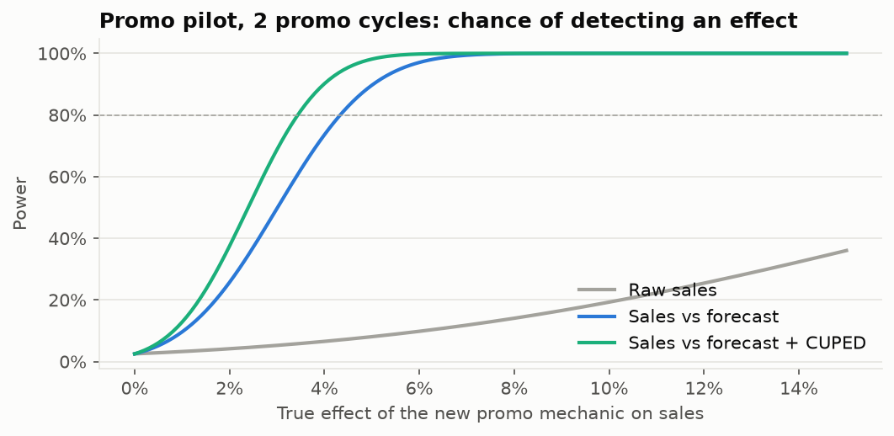

# M5 — Evaluation & monitoring

*Generated by `make eval-report`. Every number below is read from an eval output.*

## 1. Retrieval (agent's KPI / methodology search)

Dev set (15 paraphrased questions) used to choose the retriever; held-out set (10, written before tuning) is the honest score.

| Retriever | Dev R@1 | Dev R@3 | Held-out R@1 | Held-out R@3 | Held-out MRR |
|---|---|---|---|---|---|
| lexical | 40% | 60% | 40% | 90% | 0.65 |
| dense **(chosen)** | 73% | 93% | 60% | 70% | 0.65 |
| hybrid | 47% | 67% | 50% | 100% | 0.72 |

Dense embeddings (bge-small, local) rank the right document first far more often; held-out top-3 recall is lower than lexical on 10 questions, so treat the comparison as indicative.

### Playbook retrieval (governed RAG)

Held-out free-text situations: top-1 **90%**, top-3 100%. Blocked from retrieval: PB-COMP-NEAR v1 (superseded), PB-HOLIDAY v0 (approved), PB-PRICE-WAR v0 (draft). Governance leaks: **0**.

- Miss: "average ticket per shopper has fallen although visitor numbers held up" → PB-TRAFFIC-DROP (expected PB-BASKET-DROP); embeddings handle negation poorly, so the agent passes driver='basket' as a structured hint instead.

## 2. Insight-card QA gate (defect injection)

11 correct cards built from real fact packs, plus 53 copies with exactly one injected defect.

| Defect | Cards | Deterministic checks | LLM critic | Full gate |
|---|---|---|---|---|
| clean (false-alarm rate) | 11 | 0% | 0% | 0% |
| wrong number | 10 | 90% | 100% | 100% |
| sign flip | 9 | 100% | 100% | 100% |
| wow lead | 1 | 100% | 0% | 100% |
| at risk | 1 | 100% | 0% | 100% |
| missing hedge | 1 | 100% | 100% | 100% |
| store id typo | 7 | 100% | 100% | 100% |
| double negative | 4 | 100% | 0% | 100% |
| uncited action | 7 | 100% | — | — |
| causal leap | 4 | 0% | 100% | 100% |
| invented cause | 6 | 0% | 100% | 100% |
| overclaim | 3 | 0% | 100% | 100% |

- Deterministic recall **74%**, false-alarm rate **0%**.
- Full gate (deterministic OR critic) recall **100%**; critic false-alarm rate on clean cards **0%**.
- The layers are complementary: the critic never flagged wording defects (double negative, 'at risk', WoW lead) and the rules cannot judge meaning (causal leaps, invented causes, overclaims).
- Caveat: in this run 2 critic calls failed Groq's JSON validation and were counted as flags (scoring now excludes them), so the full-gate recall lower bound is 95%.
- Caveat: defects are injected into template cards, which is easier than real drafts; live card runs still let some subtler mislabels through.
- Found and fixed by this eval: IDs/counts were matched with a ±0.5% tolerance, so 'Store 1067' passed for store 1066 (typo catch rate 50% → 100%).

## 3. Agent golden set

15 questions with answers computed by SQL at eval time (groq · openai/gpt-oss-120b).

| Metric | Value |
|---|---|
| Correct answers | **87%** |
| Tool selection accuracy | 93% |
| Mean numeric accuracy (fact-check vs tool outputs) | 90% |
| Latency p50 / p95 | 14.3s / 178.8s |
| Mean tool calls per question | 0.9 |
| Tokens (prompt / completion) | 52,772 / 2,937 |

Failures:

- **pb_competitor_near_plan** — expected contains one of ['PB-COMP-NEAR']…. Answer: "…"
- **pb_store_competitor** — expected contains one of ['PB-COMP-NEAR']…. Answer: "Store 770 should launch the “defend the catch‑area” playbook for a new competitor that opened 100 m away, focusing on retaining traffic and protecting promo exe…"

### Playbook questions: before vs after the playbook RAG

| Question | Before (no playbooks) | After |
|---|---|---|
| A competitor just opened 300 metres from one of our stores. What is our approved response plan? | ❌ | ✅ |
| What should the manager of store 770 do about its recent sales drop? | ❌ | ✅ |
| How much do weekly sales typically drop when a competitor opens within 1 km of a store? | ❌ | ✅ |

Before: 0/3 on openai/gpt-oss-120b. After: 3/3 on openai/gpt-oss-20b (the 120b model's free daily token quota was exhausted). Without playbooks the agent estimated the competitor impact itself as 'about 7%' from two weeks of data with no control group; the causal estimate it now quotes is −15.4%. Two fixes came out of this: optional tool parameters must accept null (Groq rejected the call), and explain_store now returns the matched playbook so smaller models don't need a second call.

## 4. A/B test design — promo-mechanics pilot

111 lowest-lift stores, randomized 50/50; empirical power from placebo experiments on 29 historical promo weeks.

| Promo cycles | MDE raw sales | MDE sales vs forecast | MDE + CUPED | Placebo false-positive rate |
|---|---|---|---|---|
| 2 | 27.7% | 4.3% | **3.4%** | 4.8% |
| 4 | 28.1% | 3.9% | **3.2%** | 4.9% |
| 6 | 27.9% | 3.7% | **3.2%** | 5.8% |

Use log(actual/forecast) with CUPED as the primary metric: 2 promo cycles detect a 3.4% effect, where raw sales would need 27.7%. Running longer barely helps (6 cycles: 3.2%) because persistent store-to-store differences dominate; to detect smaller effects, add stores rather than weeks.

## 5. Drift & model monitoring

Reference: 2014-05-01 to 2015-04-30 (final model's training year). Current: 8 weeks to 2015-07-31.

| Feature | PSI vs training year | Status | PSI vs same weeks last year | Status |
|---|---|---|---|---|
| sales | 0.003 | stable | 0.002 | stable |
| customers | 0.016 | stable | 0.009 | stable |
| basket | 0.021 | stable | 0.043 | stable |
| promo | 0.011 | stable | 0.000 | stable |
| school_holiday | 0.013 | stable | 0.017 | stable |
| competition_active | 0.073 | stable | 0.127 | watch |
| promo2_active | 0.010 | stable | 0.020 | stable |
| days_since_reopen | 0.000 | stable | 0.000 | stable |
| lvl_recent | 0.013 | stable | 0.019 | stable |

Recent 8-week WAPE 5.8% vs baseline 6.5%; recent bias -3.4%.

**Alert:** 6 consecutive weeks of under-forecast (rule: >=6 consecutive weeks, same sign, |bias|>=2%) through 2015-07-20 → retraining trigger.

## 6. LLM observability (all logged calls)

| Provider | Model | Calls | Error rate | Rate-limited | Truncated | p50 latency | p95 latency |
|---|---|---|---|---|---|---|---|
| gemini | gemini-3.5-flash | 26 | 54% | 14 | 0 | 3.7s | 134.5s |
| gemini | gemini-3.8-flash | 1 | 100% | 0 | 0 | — | — |
| groq | openai/gpt-oss-120b | 299 | 3% | 8 | 0 | 7.4s | 36.3s |
| groq | openai/gpt-oss-20b | 104 | 2% | 0 | 0 | 11.1s | 65.7s |
| openrouter | openrouter/free | 28 | 0% | 0 | 12 | 24.3s | 46.6s |
| zro | deepseek-v4.1-flash | 16 | 38% | 3 | 0 | 37.2s | 296.1s |

Latency includes client-side waits on rate limits.
