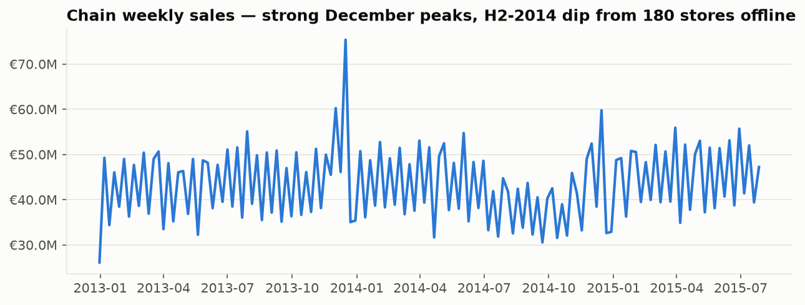
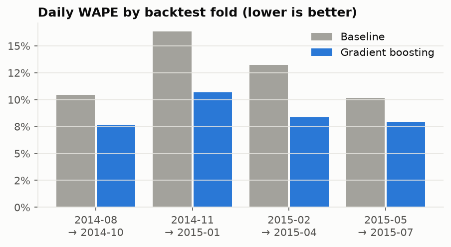
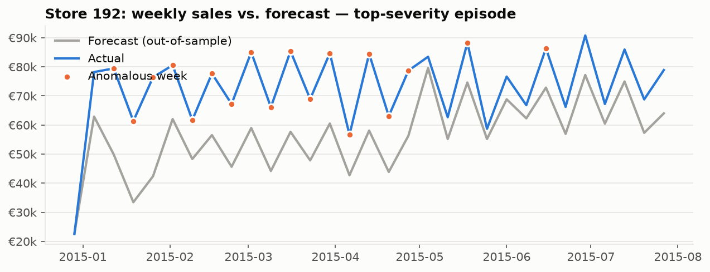
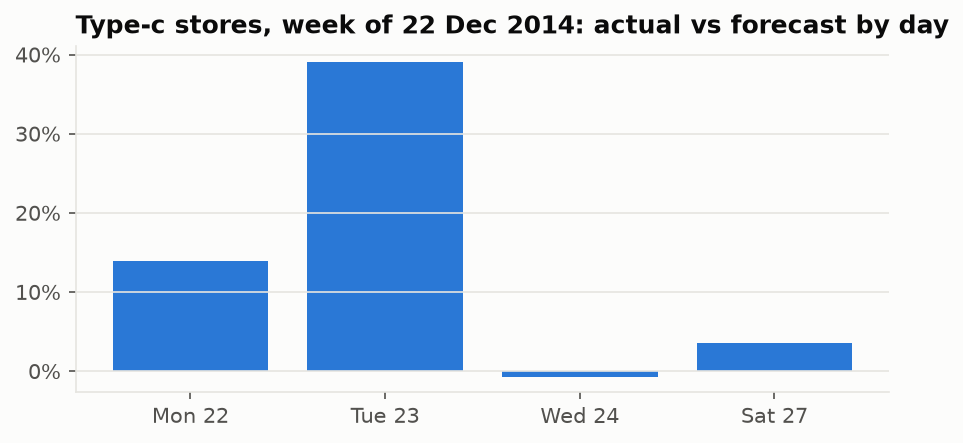
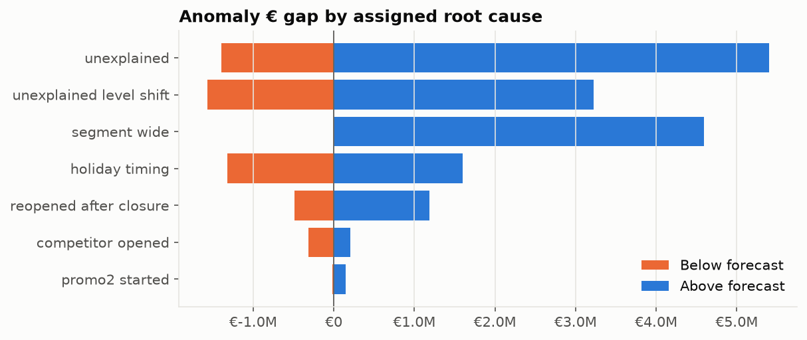
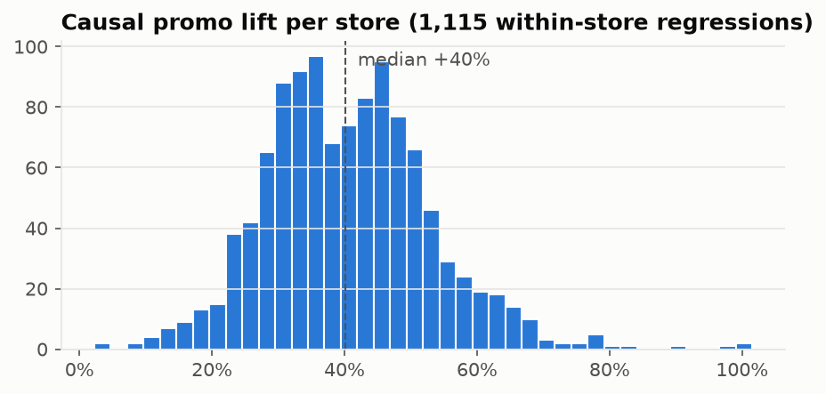
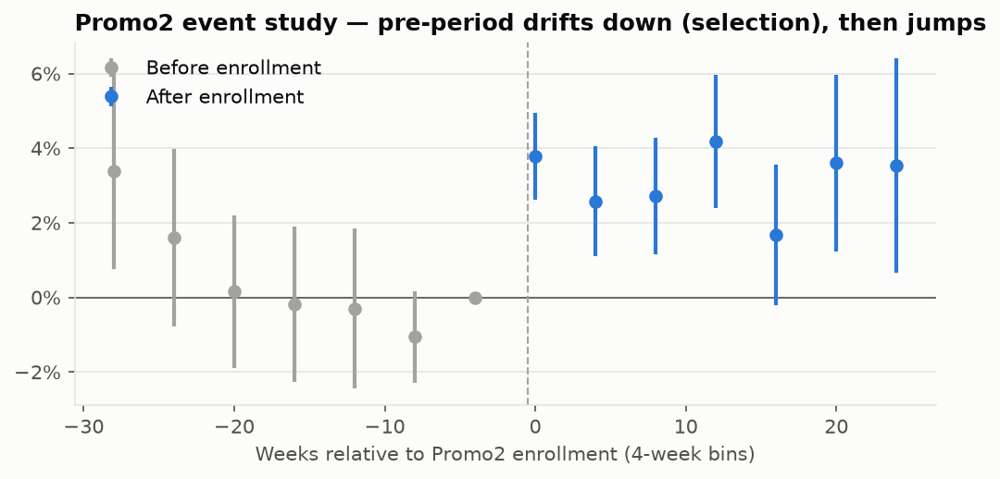

# Sales Insight Copilot — M1–M3 review

*Generated by `make report` from pipeline outputs. Data: Rossmann (Kaggle), 1,115 stores,
2013-01-01 → 2015-07-31.*

## TL;DR

- **Forecasting:** gradient boosting beats a strong store×weekday×promo baseline —
  daily WAPE **8.7%** vs 12.6%; at the store-week
  grain managers read, **6.1%** vs 9.5%.
- **Detection:** 4.7% of store-weeks flagged → 2,001
  episodes (1,476 above / 525 below forecast).
  Calibrated intervals hit ~nominal 90% coverage in folds 3–4.
- **RCA** names the Easter-week segment anomaly correctly and attributes
  1,255 of 2,001 store episodes
  mainly to **traffic** rather than basket.
- **Promo lift (causal):** **+37.8%** pooled; p10–p90 across stores
  +26% to +56%. Type-b and
  "extra"-assortment stores respond least.
- **Promo2 (causal):** **+2.9%**
  (95% CI +1.1% to +4.6%) — but
  pre-trends fail (p=0.0007). Treat as *suggestive*.

---

## M1 — Data & KPIs

- Warehouse: DuckDB, `raw → staged → marts` ([sql/](../sql/)); KPI dictionary
  [sql/kpis.yaml](../sql/kpis.yaml) (sales, customers, basket, attainment, promo lift, …).
- Quality checks enforced at build: row counts, no sales on closed days, unique store-days.
- 181 stores have a data gap (180 offline in H2-2014 for refurbishment).

| Store type | Stores | Avg customers/day | Basket (€) |
|---|---|---|---|
| a | 602 | 795 | 8.71 |
| b | 17 | 2,022 | 5.06 |
| c | 148 | 815 | 8.50 |
| d | 348 | 606 | 11.25 |

Findings worth carrying forward:
- Promo days sell +39% more (raw, Mon–Fri) — M3 tests
  whether that is causal.
- Closer competitors coincide with *higher* sales (urban-location confounding — not causal).
- Promo2 stores sell less on average (€6,550 vs €7,337/day) — selection;
  M3's DiD reverses the sign.
- Same-store sales Jan–Jul 2015 vs 2014: +3.2%.

## M2 — Forecasting & detection

Rolling-origin backtest, 4 quarterly folds (each trains only on data before it).

| Metric | Baseline | Gradient boosting |
|---|---|---|
| Daily WAPE | 12.6% | **8.7%** |
| Daily RMSPE | 0.260 | **0.225** |
| Store-week WAPE | 9.5% | **6.1%** |
| Bias | -1.1% | -1.6% |

**Interval calibration.** Raw 90% quantile intervals under-covered (83%).
Conformal widening using only the *previous* fold's errors:

| Fold | Raw coverage | Calibrated |
|---|---|---|
| 1 | 86.7% | 86.7% |
| 2 | 76.5% | 81.2% |
| 3 | 83.9% | 94.0% |
| 4 | 83.9% | 90.2% |

Fold 1 has no prior fold (left raw). Fold 2 (Nov–Jan, Christmas) still under-covers.

**Detection rule.** A store-week is anomalous if |actual/forecast − 1| ≥ 10% **and** most
open days fall outside the calibrated interval in the same direction. Consecutive weeks →
episodes, ranked by € gap.

Store 192: +46% over 16 weeks,
traffic-driven; evidence: reopened_after_closure, holiday_easter, persistent_shift.

## M3 — Root cause, causal lift, recommendations

### Root cause
Three lenses: **traffic vs basket** (exact log decomposition), **dimensional drill-down**
(Adtributor-style surprise + contribution), **event evidence** (reopening, competitor
opening, Promo2 start, holidays, segment-wide movement, persistence).

**Segment anomaly — post holiday.** Broad-based (84% of stores) and is weakest on Thu 08 Jan (-20%), around New Year / Epiphany (6 Jan, some states) (06 Jan 2015). Typical post-holiday slump; regional holiday closures also reduce trading days.

### Daily Promo lift
Promo dates are identical across stores (verified), so lift is identified **within store**
(day-of-week, month, year, holiday and adjacent-closure controls; HC1 SE).

- Pooled **+37.8%**; median store +40.1%;
  100% of stores have a CI above zero.
- Median lift by store type: a +38%, b +14%, c +42%, d +43%.
- By assortment: basic +43%, extended +37%, extra +12%.
- Heterogeneity model R² = 0.23.

### Promo2 enrollment — stacked difference-in-differences
98 newly enrolled stores in 11 monthly cohorts vs
519 never-enrolled stores; store×stack and week×stack fixed effects; SE
clustered by store.

| Specification | Effect | 95% CI |
|---|---|---|
| Main | **+2.9%** | +1.1% to +4.6% |
| Trend-adjusted | +4.7% | +3.2% to +6.3% |
| Donut (drop 12 wks pre) | +2.2% | +0.1% to +4.4% |
| Placebo (fake start −13 wks) | -2.7% | -4.5% to -0.9% |

Pre-trend joint test: χ²=23.2, p=0.0007.

**Reading:** positive in every specification, but enrolled stores were drifting down
before enrollment and the placebo is non-zero — stores were likely enrolled *because*
they were slipping. The honest conclusion is "probably positive, magnitude uncertain";
the recommendation is a randomized rollout.

### Recommendations (as of week 2015-08-02)

Portfolio-level:
- **A/B-test promo mechanics in the 111 lowest-lift stores (median lift +22% vs chain +40%); randomize half to an alternative mechanic for 2 promo cycles.** Revenue at stake ≈ €404,987/wk;
  11% of these stores are type b or extra-assortment.
- **Prioritize stock & staffing on promo weeks in the top 25 responders (median lift +50%).** (assumption-based sizing)
- **Do not scale Promo2 on observational evidence alone; run a randomized staggered rollout to settle the effect.**

Top store/portfolio actions by weekly € impact:

| # | Type | Action | €/week | Confidence |
|---|---|---|---|---|
| 1 | protect promo execution | Prioritize stock & staffing on promo weeks in the top 25 responders (median lift +50%). | €15,787 | low |
| 2 | investigate underperformance | Investigate store 722: -23% vs forecast for 1 week(s), traffic-driven. | €13,429 | medium |
| 3 | investigate underperformance | Investigate store 921: -21% vs forecast for 1 week(s), traffic-driven. | €12,334 | medium |
| 4 | investigate underperformance | Investigate store 1066: -17% vs forecast for 3 week(s), traffic-driven. | €10,537 | high |
| 5 | investigate underperformance | Investigate store 711: -19% vs forecast for 1 week(s), traffic-driven. | €8,711 | medium |
| 6 | investigate underperformance | Investigate store 753: -15% vs forecast for 1 week(s), traffic-driven. | €8,439 | medium |
| 7 | investigate underperformance | Investigate store 616: -14% vs forecast for 1 week(s), traffic-driven. | €7,517 | medium |
| 8 | investigate underperformance | Investigate store 734: -19% vs forecast for 1 week(s), traffic-driven. | €7,205 | medium |
| 9 | replicate outperformance | Study store 909: +36% vs forecast for 1 week(s); identify what is working and replicate. | €6,559 | low |
| 10 | investigate underperformance | Investigate store 463: -17% vs forecast for 1 week(s), traffic-driven. | €6,455 | medium |

---

## Known limitations → candidate tweaks for your review

1. **No holiday-proximity feature** — the model misses pre-Easter/pre-Christmas stock-up
   (the main segment anomaly, and fold-2 under-coverage). Fix: `days_to_next_closure`.
2. **Trees don't extrapolate trend** — fold bias swings (-0.6%, -2.0%, -0.8%, -2.9%);
   above-forecast episodes outnumber below 2:1. Fix: level-correction from recent residuals.
3. **Anomaly volume** (2,001 episodes) is high for a sales team to consume —
   tighten thresholds or rank harder before the LLM layer.
4. **Promo lift may include pull-forward** (non-promo weeks depressed); no margin data, so €
   is revenue not profit.
5. **Promo2 pre-trends** — try synthetic-control / matched-trend controls.
6. **RCA evidence is rule-based**; no external data (weather, local events) yet.
