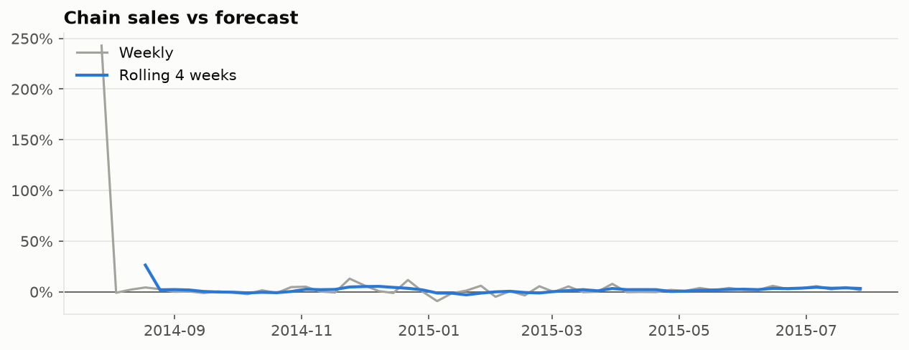
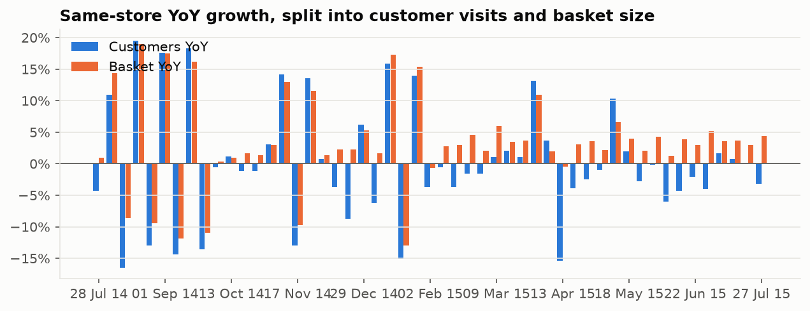
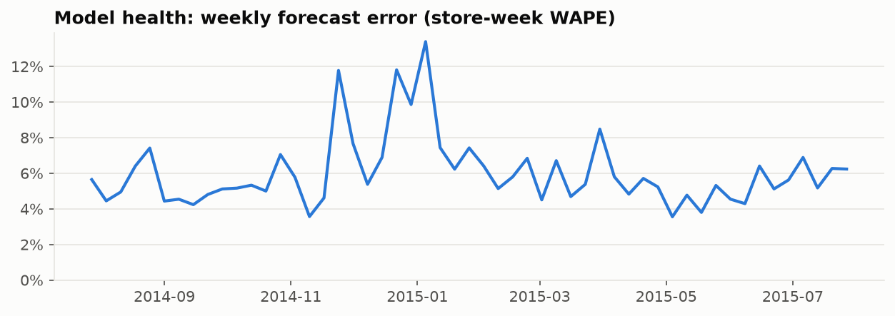

# Weekly KPI report — week of 2015-07-27

Definitions: [sql/kpis.yaml](../sql/kpis.yaml). WoW and YoY compare each day with the same
weekday 7 / 364 days earlier (same store, both open); YoY excludes the 180 stores offline
in H2-2014. Promo week: **yes** (prior week:
no). Promo weeks alternate, so WoW swings are expected.

## Scorecard

| KPI | This week | Prior week | 4-week avg (full weeks) |
|---|---|---|---|
| Sales | **€47.2M** | €39.4M | €45.0M |
| Sales vs forecast | **+1.4%** | +4.5% | +3.5% |
| Sales vs forecast, 4-wk | **+3.3%** | +3.9% | +3.8% |
| Week-over-week (day-matched) | **+42.7%** | -24.4% | +4.6% |
| YoY same-store (day-matched) | **+1.1%** | +3.0% | +3.5% |
|   …customers YoY | **-3.2%** | +0.1% | -0.2% |
|   …basket YoY | **+4.4%** | +2.9% | +3.6% |
| Customer visits | **4,502,245** | 4,476,535 | 4,726,199 |
| Avg basket | **€10.49** | €8.80 | €9.51 |
| Sales per open store-day | **€8k** | €6k | €7k |
| Promo sales share | **100%** | — | 94% |
| Mon–Sat closure rate | **0.2%** | 0.2% | 0.2% |
| Stores reporting | **1,113** | 1,113 | 1,114 |
| Anomaly rate | **4.2%** | 5.2% | 5.0% |
|   …stores below forecast | **19** | 6 | 13 |
|   …stores above forecast | **28** | 52 | 43 |
| Gap from top-10 stores | **6%** | 8% | 7% |
| Forecast error (WAPE) | **6.2%** | 6.3% | 6.1% |
| Forecast bias (+ = over-forecast) | **-1.4%** | -4.3% | -3.3% |

## By store type (this week)

| Type | Sales | vs forecast | YoY same-store | Basket | Promo share | Anomaly rate |
|---|---|---|---|---|---|---|
| a | €25.1M | +0.3% | -0.5% | €9.92 | 100% | 4.0% |
| b | €980k | +2.5% | +6.3% | €5.54 | 100% | 5.9% |
| c | €6.3M | +3.4% | +2.7% | €9.78 | 100% | 7.4% |
| d | €14.9M | +2.4% | +2.9% | €12.89 | 100% | 3.2% |

## Trends

